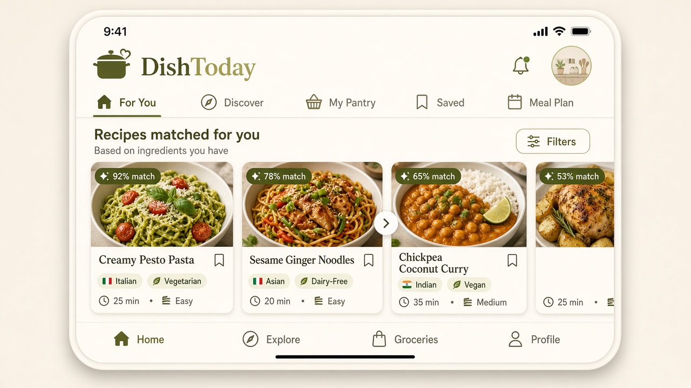
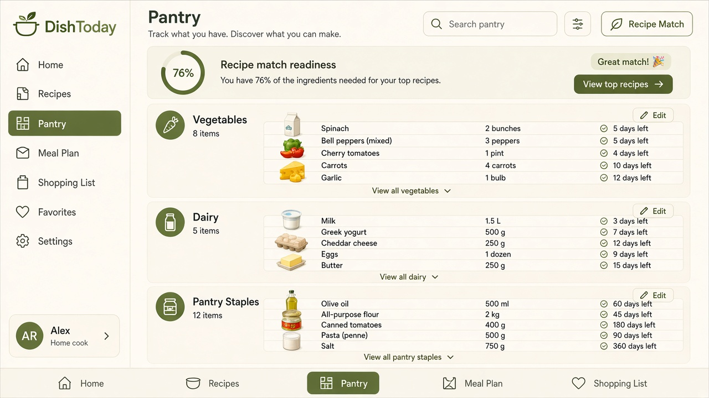
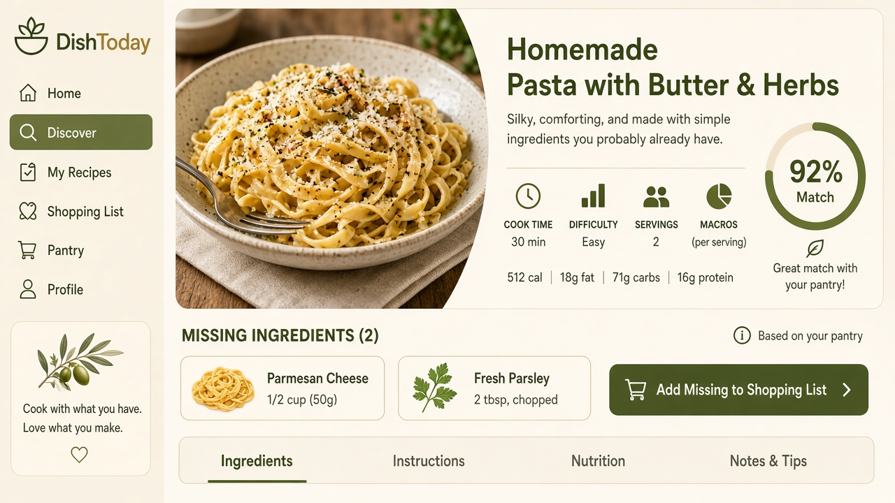
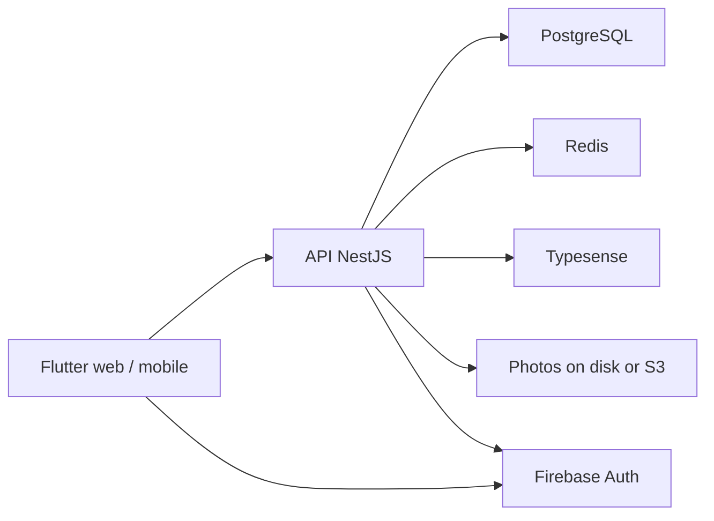

# DishToday

**What can you cook with what you already have?**

A home-cooking app that matches your pantry — name, quantity and unit — against a recipe catalogue. It is not a static cookbook: it ranks what you can make now, lists what you are missing, and moves the gaps into a shopping list.

**Live demo:** [https://dishtoday.eu](https://dishtoday.eu) · API health: [https://api.dishtoday.eu/health](https://api.dishtoday.eu/health)

**Status:** Public MVP on the web, with real email/password and Google sign-in (Firebase). `dishtoday.es` is reserved as the canonical domain once the `.es` registration is published; until then the site lives at `.eu`.

## Screenshots

| Feed | Pantry | Recipe |
| --- | --- | --- |
|  |  |  |

## Why

You open the fridge and are not sure what to cook. DishToday compares what you have with each recipe and sorts the result by match percentage. Missing items can be added to the shopping list in one step; once you mark them as bought, they go back into the pantry.

## Features

- Pantry organised by category, with quantity, unit and expiry date
- Matching that checks amounts, not just whether an ingredient name is present
- Recipe pages with time, difficulty, servings, macros, match percentage and missing items
- Feed and search, with cuisine, time and diet filters (vegetarian, vegan, gluten-free, keto)
- Publish a recipe in sections, with a photo, reorderable steps and optional ingredients
- Shopping list generated from a recipe; checked items move into the pantry
- Weekly planner (lunch and dinner) that aggregates gaps into a single shopping list
- Follow other cooks, plus likes, saves, comments and recipe reports
- Profile stats (recipes, likes, saves, pantry)
- Starting catalogue of 125 ingredients and 520 recipes, with a Wikimedia Commons photo when a free image exists
- In-app admin area (emails listed in `ADMIN_EMAILS`): open reports, delete recipes or comments, and suspend accounts

## Tech stack

| Layer | Technology |
| --- | --- |
| Client | Flutter (web, with Android/iOS folders), Riverpod, Dio, go_router |
| API | NestJS 11, TypeORM |
| Data | PostgreSQL 16 (Docker / production) or SQLite (local demo) |
| Cache | Redis 7 (optional; first page of the feed) |
| Search | Typesense 27.1, with a SQL fallback if it is not running |
| Auth | Firebase Auth (email and Google). A `dev:` bearer token is accepted only when `DEV_AUTH=true` |
| Photos | Local disk volume, or S3-compatible storage (MinIO / S3) if configured |
| Deploy | Docker Compose, nginx for the Flutter web build, Caddy as a local API proxy, TLS with Let's Encrypt in production |

## Architecture



In production the web app is served over HTTPS. The API validates the Firebase ID token. Redis caches the first page of the feed for 30 seconds. Typesense indexes ingredients and recipes; if it is down, search falls back to SQL. Photos are stored on a local volume unless MinIO or S3 is configured.

## Project structure

| Path | What it contains |
| --- | --- |
| `mobile/` | Flutter client (web, plus Android/iOS folders) |
| `backend/` | NestJS API, matching, seed data and Jest tests |
| `infra/` | Docker Compose, Caddyfile and the nginx config for the web build |
| `backend/src/recipes/compute-match.ts` | Pantry ↔ recipe matching |
| `backend/src/seed/` | Ingredient list and the 520-recipe catalogue |
| [`Plan de App.md`](Plan%20de%20App.md) | Product vision and phases (Spanish) |
| [`OPERACION.md`](OPERACION.md) | Server operations notes (Spanish) |
| [`mobile/README.md`](mobile/README.md) | Flutter client setup (Spanish) |

## Run locally

### Docker (PostgreSQL, Redis, Typesense and the API)

The compose file joins an external Docker network named `web_proxy` (used in production by the reverse proxy). Create it once:

```bash
docker network create web_proxy
cd infra
cp .env.example .env   # edit secrets
docker compose --env-file .env up --build
```

Caddy publishes the API at **http://localhost:3010**. Health check: `GET /health`.

The `web` container serves a pre-built Flutter app from `mobile/build/web` and does not expose a host port. For local work, run the Flutter client separately (see below).

### API without Docker (SQLite)

```bash
cd backend
cp ../.env.example .env   # set DB_TYPE=sqlite and DEV_AUTH=true
npm install
npm test
npm run start:dev
```

With `DEV_AUTH=true`:

```bash
curl -H "Authorization: Bearer dev:demo@dishtoday.app" http://localhost:3000/recipes/suggested
```

This mode is disabled in production. There the client sends a Firebase ID token.

### Flutter app

```bash
cd mobile
flutter pub get
flutter run --dart-define=API_BASE_URL=http://localhost:3010 --dart-define=USE_DEV_AUTH=true
```

On an Android emulator, the host API is `http://10.0.2.2:3010`. The production web build uses `API_BASE_URL=https://api.dishtoday.eu` and `USE_DEV_AUTH=false`. Details are in [mobile/README.md](mobile/README.md).

Android and iOS need `google-services.json` and `GoogleService-Info.plist` before Firebase can be used on a device. Those files are not in the repository. Sign in with Apple is present in the iOS UI but is not wired up yet.

## Deploy

Production runs from `infra/docker-compose.yml` on a VPS: PostgreSQL, Redis, Typesense and the API, with the Flutter web build served by nginx. TLS is terminated by Nginx Proxy Manager and Let's Encrypt. Caddy on port 3010 is only a host-local proxy to the API.

1. Copy [`infra/.env.example`](infra/.env.example) to `infra/.env` (and [`.env.example`](.env.example) for local API work). Fill in production values (`DEV_AUTH=false`, Firebase, `PUBLIC_BASE_URL`, Postgres, and so on). Do not commit `*.env`.
2. Build the web client (example using the official Flutter image; see [mobile/README.md](mobile/README.md)):

   ```bash
   cd mobile
   docker run --rm -v "$PWD":/work -w /work -e PUB_CACHE=/work/.pub-cache \
     ghcr.io/cirruslabs/flutter:stable \
     bash -c 'git config --global --add safe.directory "*" && flutter pub get && flutter build web --release --dart-define=API_BASE_URL=https://api.dishtoday.eu --dart-define=USE_DEV_AUTH=false'
   ```

3. Recreate the stack:

   ```bash
   cd infra
   docker compose --env-file .env up -d --build
   ```

If `mobile/build/web` was deleted and rebuilt, recreate the `web` container so nginx does not keep an old mount (`--force-recreate --no-deps web`).

Day-to-day operations (Spanish): [OPERACION.md](OPERACION.md).

## Tests

Backend unit tests live next to the code (`backend/src/**/*.spec.ts`) and cover matching, seed data, ingredient normalisation, planner aggregation and admin emails:

```bash
cd backend
npm test
npm run test:cov    # coverage report
```

The Flutter file `mobile/test/widget_test.dart` is still a placeholder.

## API, in short

| Method | Path | Purpose |
| --- | --- | --- |
| POST | `/auth/sync` | Create or update the profile after login |
| GET/PATCH | `/me` | Profile |
| PATCH | `/me/preferences` | Allergies and diets |
| GET | `/me/stats` | Profile summary |
| GET/POST | `/ingredients` | Ingredient catalogue |
| GET/POST/PATCH/DELETE | `/pantry` | Pantry |
| GET/POST/PATCH/DELETE | `/shopping` | Shopping list |
| POST | `/shopping/from-recipe/:id` | Add what a recipe is missing |
| POST | `/shopping/checkout` | Move checked items into the pantry |
| GET | `/recipes/suggested` | Ranking by pantry match |
| GET | `/recipes/search` | Search with filters |
| GET | `/feed` | Paginated feed, with `matchPct` |
| GET/POST | `/recipes` and `/recipes/:id` | Recipe page and publishing |
| POST/DELETE | `/recipes/:id/likes` and `/saves` | Likes and saves |
| GET/POST | `/recipes/:id/comments` | Comments |
| POST | `/recipes/:id/reports` | Report a recipe |
| GET/PUT/POST | `/planner`, `/planner/slots`, `/planner/shopping` | Weekly plan and shopping from the plan |

## Recipes and photos

Seed recipe text was written for this project. Photos come from Wikimedia Commons (CC BY, CC BY-SA, CC0 or public domain) and the recipe stores the attribution. A few recipes have no photo because no suitable free image was found.

Regenerate the catalogue JSON with `python3 backend/scripts/build-bulk-recipes.py`.

## What is not in git

`.env`, the Firebase service account and `mobile/build/`. See [`.env.example`](.env.example) for the variable list. The Firebase web app key in the client is public by design and is limited by the authorised domains in the Firebase project.

## Author

[Agustín Rubí Hernández](https://github.com/AgustinRH)
