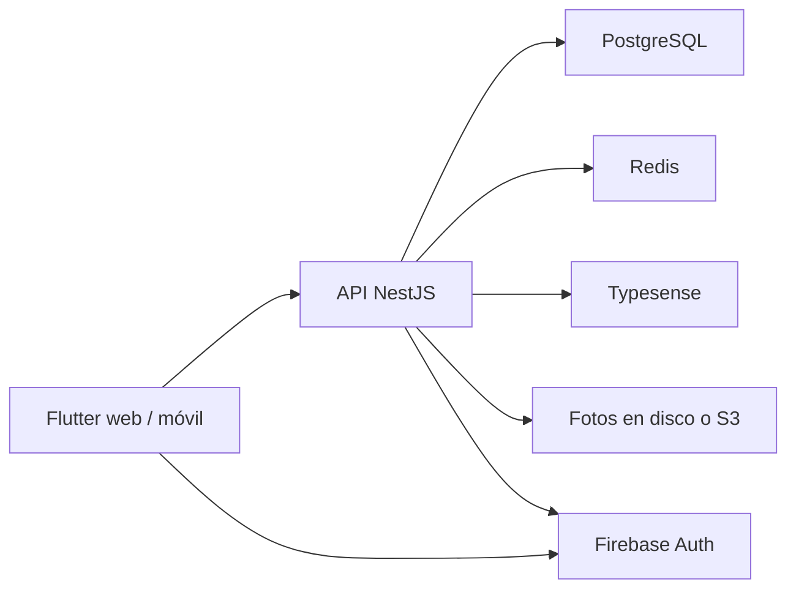

# DishToday

**What can you cook with what you already have?**

App de cocina casera que cruza tu despensa con un catálogo de recetas. No es un recetario estático: dice qué puedes hacer ahora, qué te falta y lo pasa a la lista de la compra. Hay feed para publicar, guardar y comentar.

Demo en producción: **[https://dishtoday.eu](https://dishtoday.eu)**  
API: [https://api.dishtoday.eu/health](https://api.dishtoday.eu/health)

El login es real (correo o Google). `dishtoday.es` será el nombre canónico cuando el registro `.es` publique el dominio; hasta entonces la web vive en `.eu`.

## Qué resuelve

Abres la nevera y no sabes qué cocinar. DishToday compara lo que tienes —nombre, cantidad y unidad— con cada receta y ordena el resultado por coincidencia. Si falta algo, un gesto lo mete en la compra; al marcar lo comprado, vuelve a la despensa.

## Qué incluye

- Despensa por categorías, con cantidad, unidad y caducidad.
- Matching que no se queda en “tienes el ingrediente”: compara si llegas a la cantidad.
- Ficha de receta con tiempo, dificultad, raciones, macros, porcentaje de coincidencia y faltantes.
- Feed y búsqueda con filtros de cocina, tiempo y dieta (vegetariana, vegana, sin gluten, keto).
- Publicar receta por secciones, con foto, pasos reordenables e ingredientes opcionales.
- Lista de la compra generada desde una receta, y paso de lo comprado a la despensa.
- Plan de la semana (comida y cena) que junta lo que falta y lo pasa a una sola lista de la compra.
- Denunciar una receta; las denuncias abiertas se revisan en el panel de administración.
- Perfil con estadísticas (recetas, me gusta, guardadas, despensa).
- Catálogo de unos 125 ingredientes y más de 500 recetas de partida, con foto cuando hay una imagen libre.
- Auth con Firebase (correo y Google) en la web. En local se puede usar un token de desarrollo.
- Zona de administración (solo los emails de `ADMIN_EMAILS`): denuncias, borrar recetas y comentarios, y suspender cuentas.

## Arquitectura



La web de producción se sirve detrás de HTTPS. La API valida el ID token de Firebase. Redis cachea la primera página del feed. Typesense indexa ingredientes y recetas; si no está, la búsqueda cae a SQL. Las fotos van a disco local si no hay MinIO o S3.

## Stack

| Capa | Tecnología |
| --- | --- |
| Cliente | Flutter, Riverpod, Dio, go_router |
| API | NestJS 11, TypeORM |
| Datos | PostgreSQL 16 (producción) o SQLite (demo local) |
| Caché | Redis 7 |
| Búsqueda | Typesense, con fallback SQL |
| Auth | Firebase Auth; token `dev:` solo si `DEV_AUTH=true` |
| Fotos | Volumen local o almacenamiento compatible con S3 |
| Despliegue | Docker Compose, nginx, Let's Encrypt |

## Cómo está organizado

| Ruta | Qué hay |
| --- | --- |
| `mobile/` | App Flutter (web, y carpetas Android/iOS) |
| `backend/` | API, matching, seed y tests |
| `infra/` | Docker Compose y Caddy |
| `backend/src/recipes/compute-match.ts` | Coincidencia despensa ↔ receta |
| `backend/src/seed/` | Ingredientes y catálogo de recetas |
| `Plan de App.md` | Visión de producto y fases |

Notas de operación del servidor: [OPERACION.md](OPERACION.md).

## Arranque local

```bash
cp .env.example .env
cd infra
docker compose up --build
```

La API queda en el puerto que publique Caddy (por defecto `3010` en local). Salud: `GET /health`.

Sin Docker, la API puede arrancar en SQLite:

```bash
cd backend
cp ../.env.example .env   # DB_TYPE=sqlite y DEV_AUTH=true
npm install
npm test
npm run start:dev
```

Con `DEV_AUTH=true`:

```bash
curl -H "Authorization: Bearer dev:demo@dishtoday.app" http://localhost:3000/recipes/suggested
```

Ese modo está apagado en producción. Ahí el cliente manda el ID token de Firebase.

### App

```bash
cd mobile
flutter pub get
flutter run --dart-define=API_BASE_URL=http://localhost:3010 --dart-define=USE_DEV_AUTH=true
```

En el emulador Android, la API del host es `http://10.0.2.2:3010`. La web de producción se compila con `API_BASE_URL=https://api.dishtoday.eu` y `USE_DEV_AUTH=false`. El detalle está en [mobile/README.md](mobile/README.md).

Android e iOS necesitan `google-services.json` y `GoogleService-Info.plist` antes de usar Firebase en el móvil. Esos archivos no van en el repositorio.

## API, en corto

| Método | Ruta | Para qué |
| --- | --- | --- |
| POST | `/auth/sync` | Crea o actualiza el perfil tras el login |
| GET/PATCH | `/me` | Perfil |
| PATCH | `/me/preferences` | Alergias y dietas |
| GET | `/me/stats` | Resumen del perfil |
| GET/POST | `/ingredients` | Catálogo y alta de ingredientes |
| GET/POST/PATCH/DELETE | `/pantry` | Despensa |
| GET/POST/PATCH/DELETE | `/shopping` | Lista de la compra |
| POST | `/shopping/from-recipe/:id` | Añade lo que falta para una receta |
| POST | `/shopping/checkout` | Pasa lo marcado a la despensa |
| GET | `/recipes/suggested` | Ranking por coincidencia |
| GET | `/recipes/search` | Búsqueda con filtros |
| GET | `/feed` | Feed paginado, con `matchPct` |
| GET/POST | `/recipes` y `/recipes/:id` | Ficha y publicación |
| POST/DELETE | `/recipes/:id/likes` y `/saves` | Me gusta y guardar |
| GET/POST | `/recipes/:id/comments` | Comentarios |

## Recetas y fotos

El texto de las recetas de semilla está escrito para este proyecto. Las fotos vienen de Wikimedia Commons (licencias CC BY, CC BY-SA, CC0 o dominio público) y la ficha guarda la atribución. Unas pocas recetas no tienen foto porque no había una imagen libre que encajara.

Regenerar el JSON del catálogo: `python3 backend/scripts/build-bulk-recipes.py`.

## Qué no está en git

`.env`, la cuenta de servicio de Firebase y `mobile/build/`. El ejemplo de variables es [.env.example](.env.example). La clave de la app web de Firebase sí está en el cliente: es pública por diseño y queda limitada por los dominios autorizados del proyecto.
